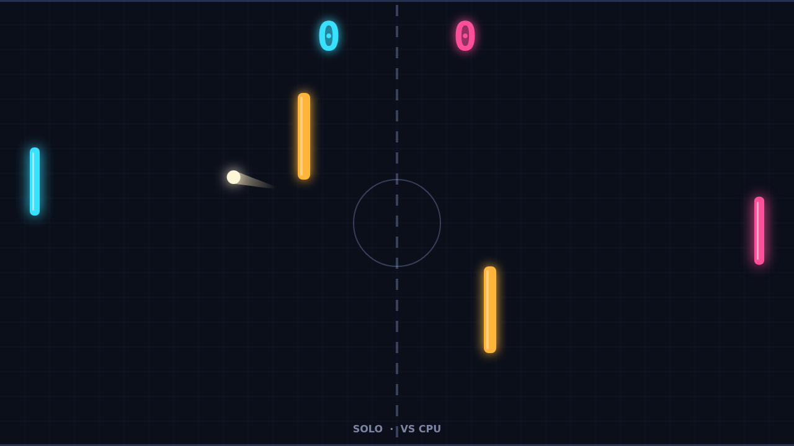

# Carom

Carom is a fast, neon-lit paddle duel played across a dark field. You hold the
left paddle; across the net waits a sharp CPU opponent or a friend sharing your
keyboard. Two amber posts stand in the middle of the field, turning every rally
into a game of angles: send the ball straight and it may clip a post and come
screaming back at you, or bank it cleanly past and leave your opponent
stranded.

Every match opens with the ball resting at centre court and a one-second
countdown before it serves toward you. Rallies start gently, but each return
speeds the ball up, so a long exchange turns into a blur of comet trails and
split-second reads. Lose a point and the next serve comes your way; the first
player to 11 wins, but only by two clear points, so a 10–10 game can stretch
into a nerve-wracking deuce.

The heart of Carom is spin. Swing your paddle up or down as you strike and the
ball bends in flight, curving the way you moved and slowly straightening out as
the spin fades. Strike near the paddle's tip for a steep angle or the centre to
drive it flat, then add a down-swing to curl it around a post your opponent
thought was covering them. Spin carries through wall and post bounces, so a
well-placed shot can kiss the top wall, bend back toward the middle, and slip
behind the paddle that was waiting for it.

Play Solo against the CPU, who tracks the ball with a human-like delay, or
Versus with W and S on one side and the arrow keys on the other. Pause any
time, mute with M, and jump straight back into another match when the last
point falls.
